# Assignment 5 – JavaScript Basics

Name: Dinislam Mirzadiyar  
Group: IT-2503

# Part 1 – Profile Object, Data Types & Arithmetic

In Part 1, I created a JavaScript object called userProfile. It contains different data types: a string for the name, a number for the birth year, a boolean for the developer status, and an array for hobbies.

I also calculated the user's current age using the current year and birth year. The number of hobbies was calculated using the length property of the hobbies array.

Screenshots:

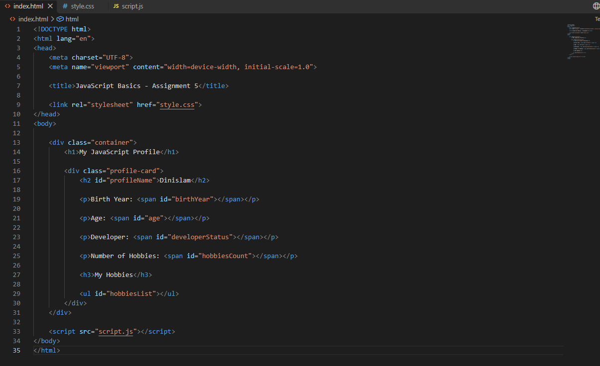

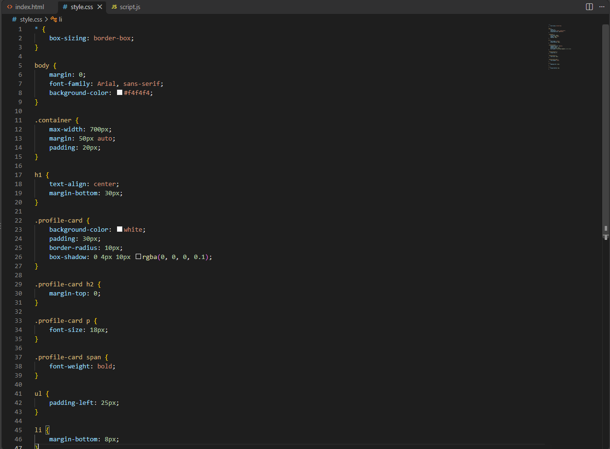

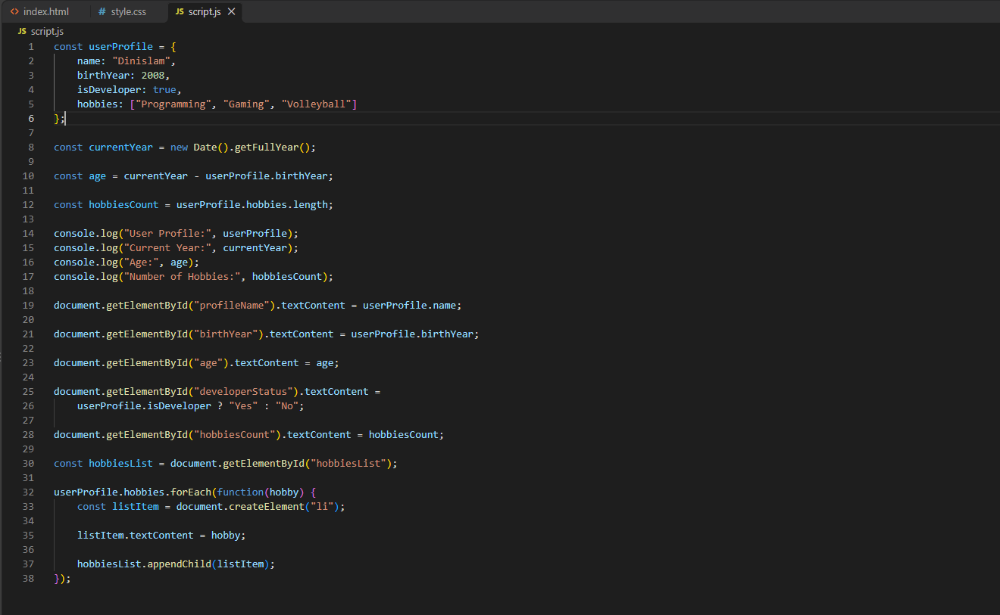

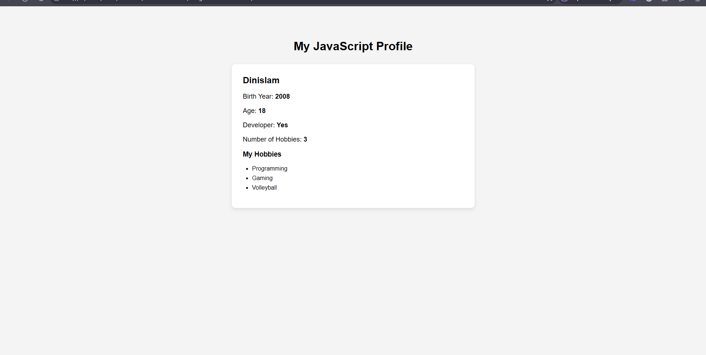

# Part 2 – Form Input & Event Responses

In Part 2, I added a form where the user can enter a username and birth year. When the form is submitted, JavaScript gets the input values and updates the userProfile object.

The age is also recalculated after changing the birth year. I used an event listener to respond to the form submission without reloading the page.

Screenshots:

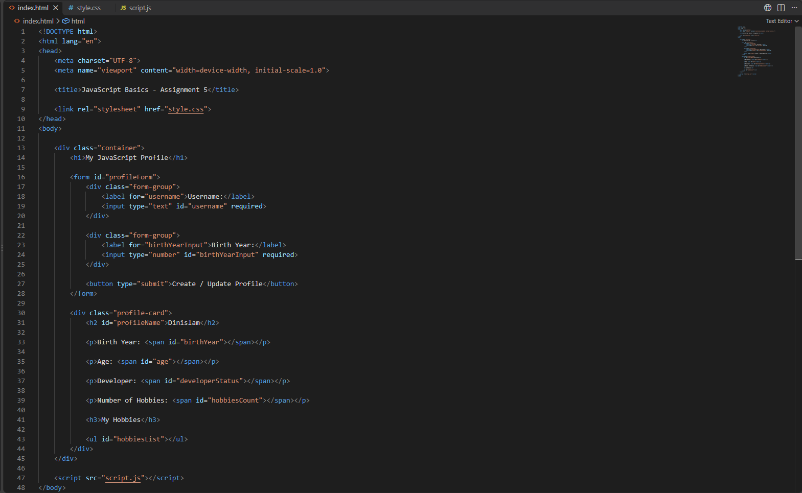

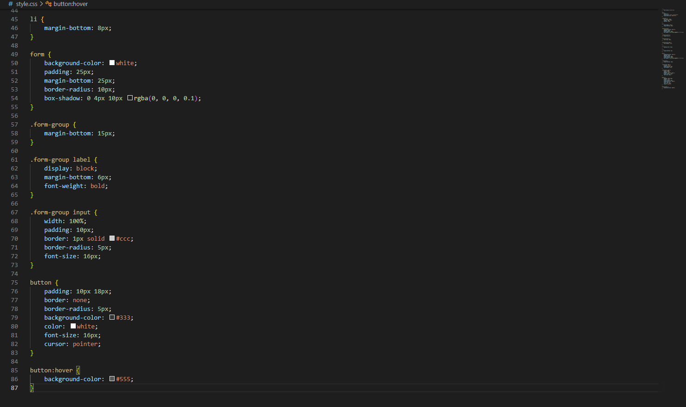

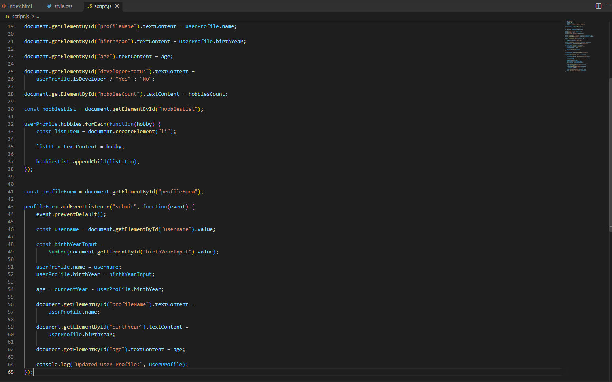

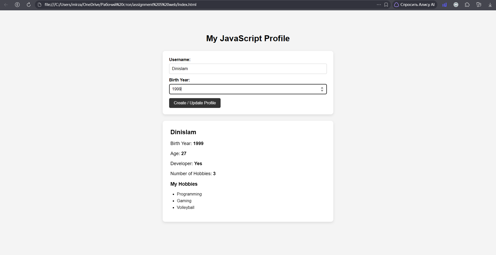

# Part 3 – DOM List Manipulation

In Part 3, I made the hobbies list interactive. The user can enter a new hobby and add it to the list using the Add Item button.

The Remove Item button removes the last hobby from the list. JavaScript creates and removes HTML list elements using DOM manipulation.

Screenshots:

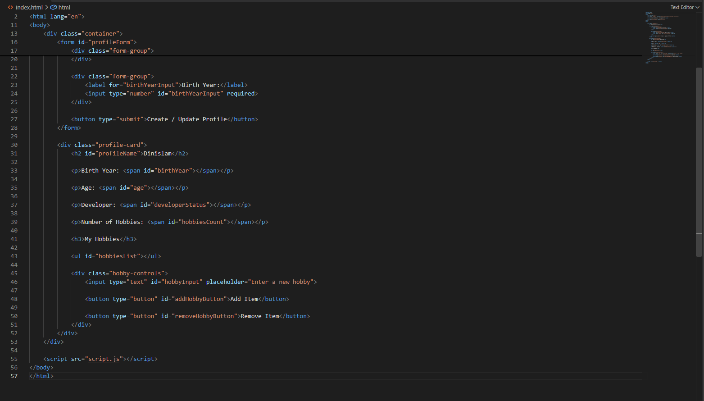

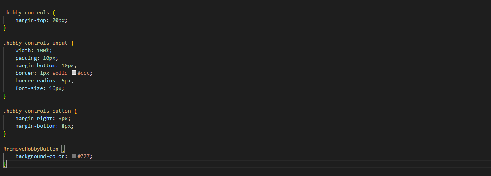

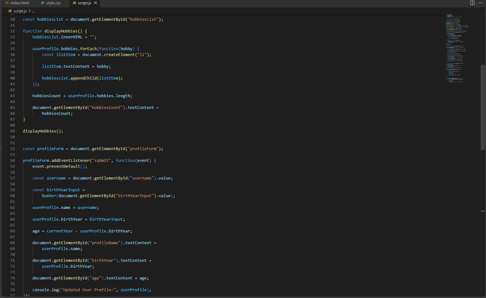

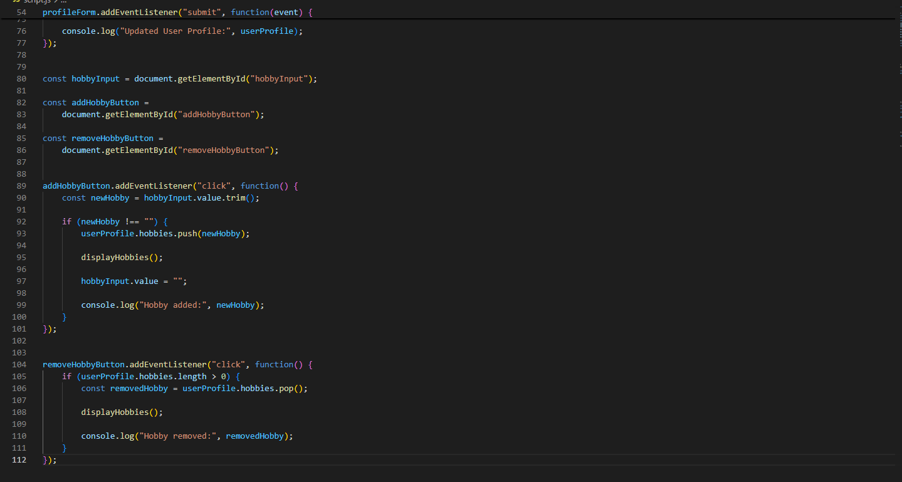

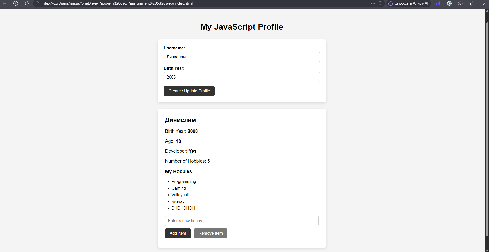

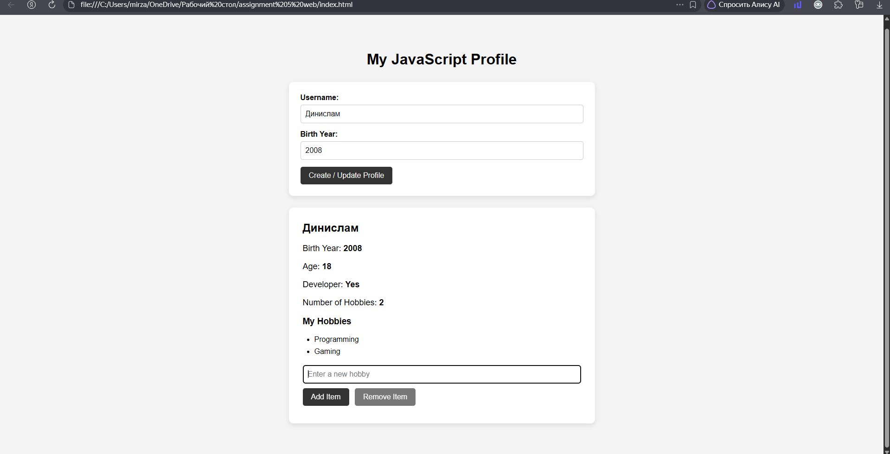

# Work Process

First, I created the userProfile object and calculated the user's age and number of hobbies. Then I added a form and an event listener to update the profile information.

Finally, I made the hobbies list interactive by adding buttons for creating and removing list items. All parts are connected together and use the same userProfile object.

# Conclusion

This assignment helped me understand the basics of JavaScript, DOM manipulation, objects, arrays, arithmetic operations, and event listeners. I also learned how JavaScript can change HTML elements dynamically when the user interacts with a web page.